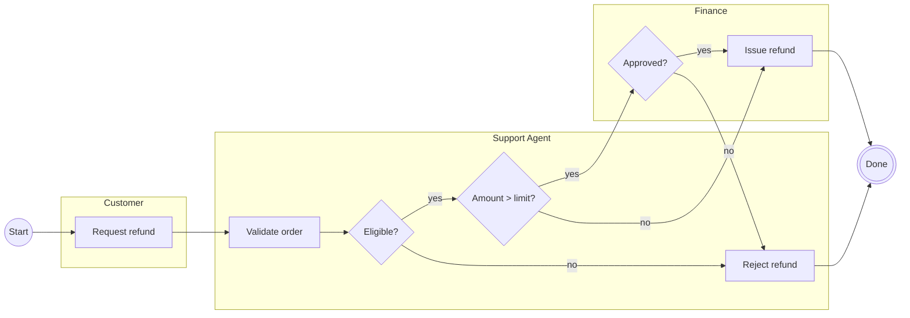
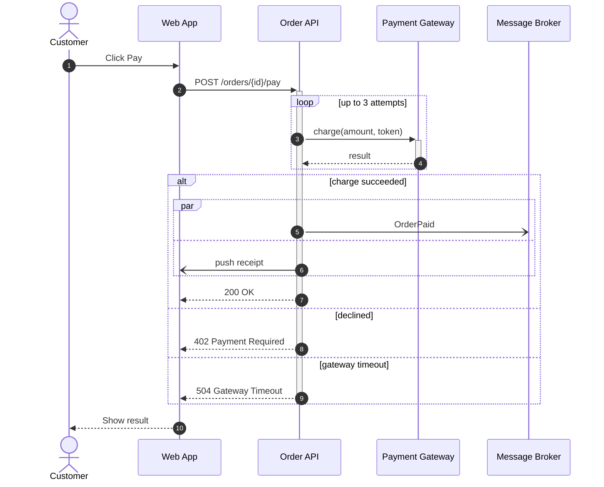
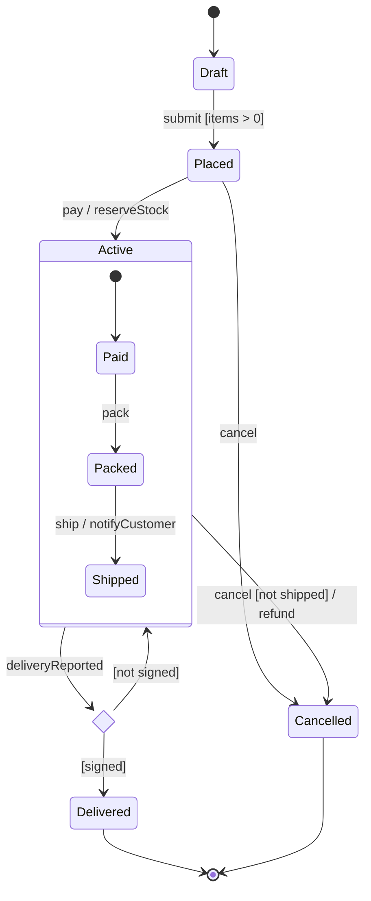
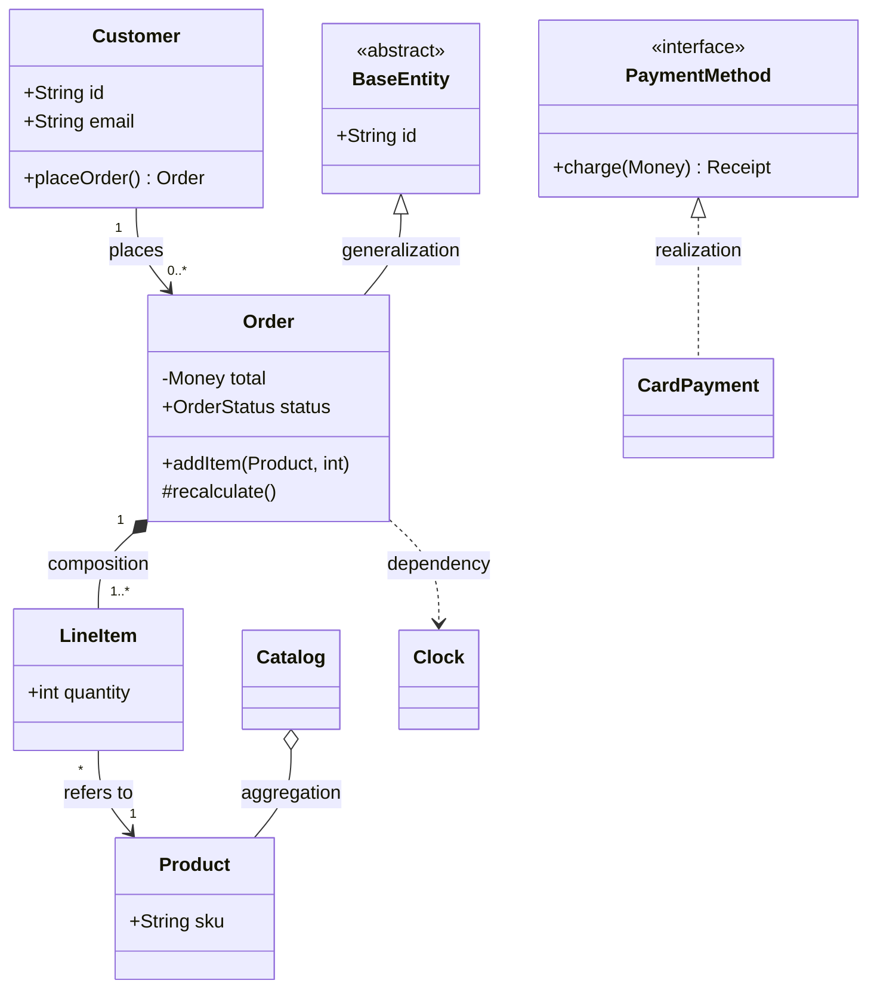
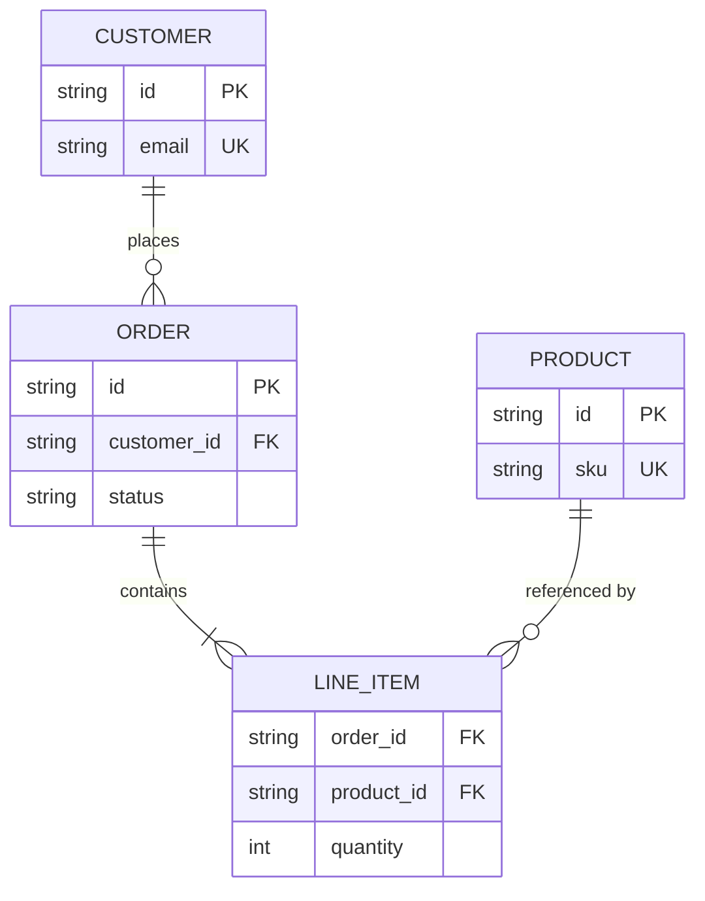
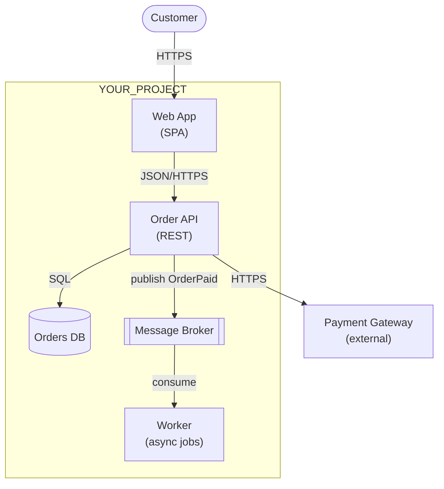

# Mermaid Patterns — Canonical, Render-Checked Shapes

> Synthetic "order" domain. Replace names with YOUR_PROJECT's domain language found in code or the business glossary. Every example carries the header + `accTitle`/`accDescr`. Targets Mermaid ≥10 syntax that GitHub renders (no beta diagram types).

## 1. Activity with Swimlanes (flowchart + subgraphs)

Notes: every diamond edge labeled; one start; one explicit end; lanes = one owner each; direction `LR` because lanes read top-to-bottom as rows.

## 2. Sequence with `alt`, `loop`, `par`, activation, async

Notes: `->>` sync, `-->>` reply, `-)` async; `autonumber` makes steps citable in reviews and test IDs.

## 3. State Machine with Composite State and Choice

Notes: states are adjectives/past participles; transitions `event [guard] / action`; every state reachable and every non-final state has an exit.

## 4. Class Diagram with Every Relationship Type

Hand-authored class diagrams rot — generate this from code where a generator exists (see [tooling.md](tooling.md)).

## 5. ER Diagram

## 6. Component / C4-style Container (flowchart approximation)

Mermaid's native `C4Context` syntax is experimental and renders inconsistently on GitHub — prefer this approximation or C4-PlantUML.

## 7. Overview + Detail Linking

When an overview exceeds ~15 elements, collapse a region into one node and link the detail file:

- Overview node: `Pay["Process payment (see payment.sequence.mmd)"]`
- Optional clickable link (only with default `securityLevel: strict` + `click Pay href "path/to/detail.md"`) — Mermaid allows `href` links in strict mode; JS callbacks require `loose` and are forbidden (see [security-checklist.md](security-checklist.md)).
