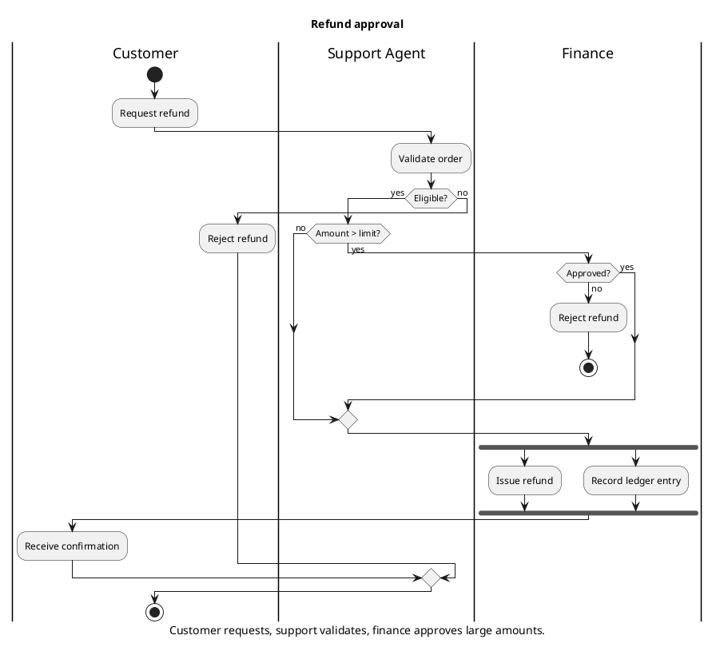
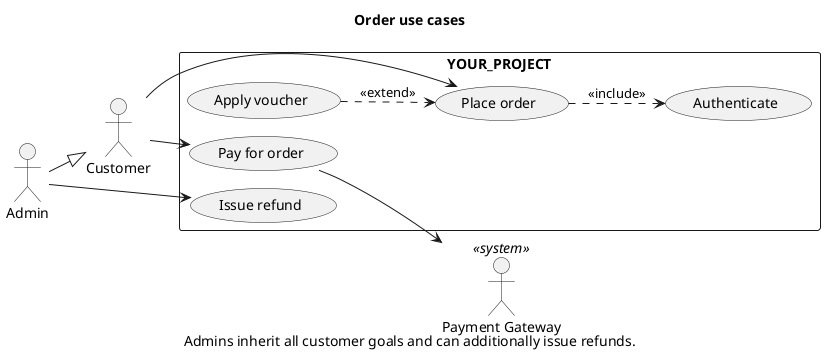
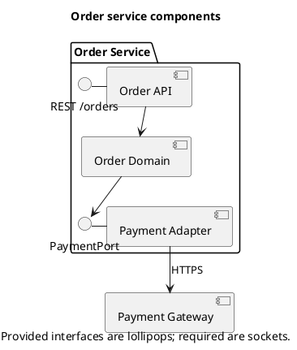
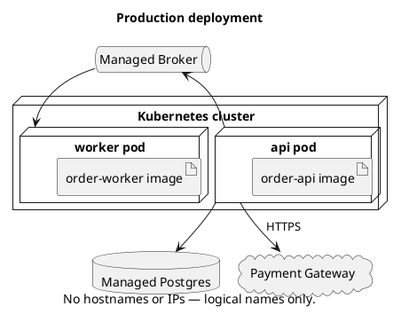
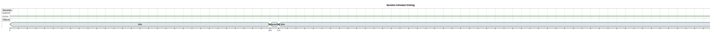

# PlantUML Patterns — When Mermaid Cannot Express It

> Use PlantUML only for: true activity swimlanes with fork/join, use case, component, deployment, timing, C4. Everything else → Mermaid (zero-install rendering on GitHub/GitLab).
> Every file: `@startuml` … `@enduml`, `'` comment header, `title` + `caption`. Use `!pragma layout smetana` to avoid the Graphviz dependency.

## 1. Activity with `|Lane|` Partitions and Fork/Join



Never mix new syntax (`:action;`, `if () then`) with legacy syntax (`(*) --> "action"`) — the parser fails or silently misrenders.

## 2. Use Case with Include / Extend and Actor Generalization



## 3. Component Diagram



## 4. Deployment Diagram



## 5. C4-PlantUML Container View

```plantuml
@startuml c4-container
' Title: YOUR_PROJECT container view
' Question: How do YOUR_PROJECT's containers fit together?
' Audience: Engineers, architects
' Source of truth: path/to/your/docker-compose.yml
' Last verified: YYYY-MM-DD
!include path/to/vendored/C4_Container.puml
title YOUR_PROJECT — Container view
Person(customer, "Customer")
System_Boundary(sys, "YOUR_PROJECT") {
  Container(web, "Web App", "SPA", "Customer UI")
  Container(api, "Order API", "REST", "Order logic")
  ContainerDb(db, "Orders DB", "SQL")
  ContainerQueue(mq, "Broker", "AMQP/Kafka")
}
System_Ext(pg, "Payment Gateway")
Rel(customer, web, "Uses", "HTTPS")
Rel(web, api, "Calls", "JSON/HTTPS")
Rel(api, db, "Reads/writes")
Rel(api, mq, "Publishes OrderPaid")
Rel(api, pg, "Charges", "HTTPS")
SHOW_LEGEND()
@enduml
```

Vendor `C4_Container.puml` into the repo and `!include` it locally — `!includeurl` to GitHub pulls remote code at render time (see [security-checklist.md](security-checklist.md)).

## 6. Timing Diagram



## 7. Shared Style File

Keep one repo-local style include instead of per-diagram `skinparam` blocks:

```plantuml
' path/to/your/docs/diagrams/_style.iuml
skinparam shadowing false
skinparam defaultFontName "Helvetica"
skinparam ArrowColor #333333
skinparam ActivityBorderColor #333333
```

Use with `!include _style.iuml` right after `@startuml`.
